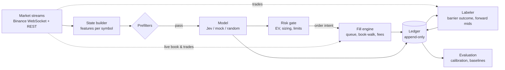

# jev-scalper — Architecture

Paper-trading scalper for Binance USDⓈ-M meme coin perpetuals. Live mainnet data, simulated fills,
real fees. Jev (TypeSafe System One model) is the signal classifier. See `CLAUDE.md` for goals,
research findings and build order.

## Overview



Decision path: streams → state → prefilter → model → risk gate → fill engine.
Grading path: every model call → labeler → evaluation. The labeler grades **all** calls,
including ones the risk gate rejected.

Going live later means replacing only `FillEngine` with a real Binance executor behind the same
interface. Nothing upstream changes.

## Module layout

```
src/
  config.ts           env + strategy params (barriers, horizon, leverage, limits)
  binance/
    rest.ts           exchangeInfo, 24h ticker, depth snapshot, OI, premiumIndex, fundingInfo, commissionRate
    streams.ts        combined WebSocket, reconnect, per-symbol subscriptions
    book.ts           local L2 book: snapshot + diff sync, sequence checks, resync on gap
    tape.ts           aggTrade ring buffer per symbol
    candles.ts        1m kline buffer per symbol
  universe.ts         symbol selection, refreshed every few minutes
  state/
    features.ts       pure functions: indicators, depth bands, CVD, ranges
    builder.ts        assembles MarketState per symbol
  models/
    model.ts          Model interface
    jev.ts            TypeSafe client, question schema, deadline/timeout
    mock.ts           rule-based baseline (momentum + imbalance + flow)
    random.ts         random baseline
  risk/gate.ts        EV check, filters, sizing, kill switch → OrderIntent | null
  sim/
    fillEngine.ts     maker queue model, taker book-walk, latency, TP/SL, funding, liquidation
    account.ts        fake balance, positions, margin
  ledger/
    db.ts             SQLite, append-only tables
    events.ts         typed event writers
  labeler.ts          resolves barrier outcomes + forward mids
  eval/               offline scripts: calibration, Brier, baseline comparison, PBO/DSR
  loop.ts             scheduler: one decision cycle per symbol per interval
  index.ts            wiring, graceful shutdown
```

## Components

### 1. Market streams (`binance/`)
- Base: `wss://fstream.binance.com/stream?streams=...` (combined), REST `https://fapi.binance.com`.
- Per symbol: `<sym>@depth@100ms`, `<sym>@aggTrade`, `<sym>@markPrice@1s`, `<sym>@kline_1m`.
- Book sync: buffer diffs → fetch `/fapi/v1/depth` snapshot → drop stale diffs → apply in order;
  on sequence gap, resync. Follow Binance's documented local-book procedure exactly.
- Universe refresh (every few minutes): `/fapi/v1/exchangeInfo` (status, listing time, tick/lot size),
  `/fapi/v1/ticker/24hr` (volume, change). Funding interval per symbol from `/fapi/v1/fundingInfo`.
- Respect REST weight limits; stagger snapshots when adding many symbols.
- **Mainnet only.** Testnet books are fake.

### 2. State builder (`state/`)
Deterministic and pure: same inputs → same `MarketState`. All math lives here, never in the model.
Output must be compact (token cost) and relative (bps, ratios) rather than raw prices where possible.

### 3. Prefilters
Cheap code checks before spending a model call: min 24h volume, max spread, min depth within 25 bps,
symbol trading status, not in cooldown, not already holding a position.

### 4. Model (`models/`)
Same interface for Jev and baselines, selected by config. Several can run in parallel on the same
state (each with its own simulated account) for apples-to-apples comparison.

Main question (triple barrier): *"Will price hit +X% before −X% within N minutes?"*
The question text must state the goal, the horizon, and the cost context (fees + slippage in bps).
Optional second question: regime (organic momentum / manipulation / listing event / exhaustion).
Hard deadline on every call; timeout or error = no trade, logged as such.

### 5. Risk gate (`risk/gate.ts`)
Final authority. Converts a decision into an `OrderIntent` or `null`.
- EV: `p·TP − (1−p)·SL − fees − expectedSlippage > 0` (all in bps).
- Fixed leverage from config. Never from the model.
- Max open positions, max notional per symbol, liquidity floor, spread cap.
- Daily loss kill switch; cooldown per symbol after a stop.
- If nothing qualifies this cycle, do nothing.

### 6. Fill engine (`sim/`) — pessimistic by design
- **Latency:** an intent becomes active at `decisionStart + modelLatency + simulatedRtt`. Fill
  against the book and tape at that time, not at decision time.
- **Maker entries (post-only):** record queue size ahead at your price when posted. Fill only after
  that much volume trades at your price, or price trades through it. A touch is not a fill.
  Cancel unfilled entries after a timeout.
- **Taker exits (IOC):** walk book levels for the full size; never fill at mid.
- **TP/SL:** evaluated on real trade prints; stop fills as taker with book-walk slippage.
- **Fees:** from `/fapi/v1/commissionRate` (requires an API key with read permission), maker vs taker.
- **Funding:** applied at each symbol's own settlement times using the mark-price stream's rate.
- **Liquidation:** at simulated leverage on mark price.

### 7. Ledger (`ledger/`)
Append-only SQLite. Never update rows; write new events. Everything needed to replay a decision.

### 8. Labeler (`labeler.ts`)
For every model call: watch the tape from decision time until a barrier hits or the horizon
expires. Record which barrier hit first (or neither), time to hit, and mids at +10 s, +30 s, +60 s, +5 min.

### 9. Evaluation (`eval/`)
Offline scripts over the ledger:
- Calibration: bucket `pUpFirst` into deciles; compare to observed hit rate. Brier score.
- P&L after all costs per model, per liquidity tier, per regime.
- Baselines through the identical pipeline: mock, random, never-trade.
- PBO / Deflated Sharpe when comparing many parameter sets.

## Core types (sketch)

```ts
type Side = "buy" | "sell";
type LiquidityTier = "large" | "mid" | "small";

interface MarketState {
  symbol: string;
  ts: number;
  mid: number;
  spreadBps: number;
  bookImbalance: number;                        // -1..1 within 1% of mid
  depthUsd: Record<"10" | "25" | "50", { bid: number; ask: number }>;
  returnsBps: { s10: number; m1: number; m5: number; m15: number; h1: number };
  flow: { buyUsd: number; sellUsd: number; cvdUsd: number; trades: number; window: string };
  indicators: { rsi14: number | null; vol20Bps: number | null; midVsSma20Bps: number | null;
                midVsSma50Bps: number | null; rangePos20: number | null };
  perp: { fundingBps: number; fundingIntervalH: number; premiumBps: number;
          oiUsd: number; oiChange1hPct: number; fundingChange1hBps: number };
  context: { vol24hUsd: number; change24hPct: number; distFrom24hHighBps: number;
             liquidityTier: LiquidityTier; minutesSinceListing: number };
  costs: { makerFeeBps: number; takerFeeBps: number; estSlippageBps: number };
}

interface Decision {
  model: string;                                // "jev" | "mock" | "random"
  pUpFirst: number;                             // P(+X% before −X%)
  pDownFirst: number;
  pNeither: number;                             // horizon expires first
  regime?: { label: string; p: Record<string, number> };
  latencyMs: number;
  inputTokens: number;
  error?: string;                               // timeout / API error → no trade
}

interface Model {
  readonly name: string;
  decide(state: MarketState, q: { barrierBps: number; horizonMin: number }): Promise<Decision>;
}

interface OrderIntent {
  symbol: string;
  side: Side;
  notionalUsd: number;
  leverage: number;
  entry: { type: "postOnly"; price: number; timeoutMs: number };
  tpBps: number;
  slBps: number;
}

interface FillEngine {                          // sim now, live executor later
  submit(intent: OrderIntent, activeAt: number): Promise<string>;   // returns orderId
  onBook(symbol: string, book: unknown): void;
  onTrade(symbol: string, trade: unknown): void;
}
```

## Ledger schema (sketch)

| Table | Key columns |
|---|---|
| `decisions` | id, ts, symbol, model, state_json, question_json, answers_json, p_up, p_down, p_neither, latency_ms, input_tokens, error |
| `gate_results` | decision_id, accepted, reason, ev_bps |
| `orders` | id, decision_id, ts, symbol, side, type, price, size, active_at, status |
| `fills` | order_id, ts, price, size, liquidity (maker/taker), fee_usd, slippage_bps |
| `funding` | ts, symbol, position_size, rate, amount_usd |
| `positions` | event log: open / tp / sl / timeout / liquidation, with P&L |
| `labels` | decision_id, barrier_hit (up/down/none), time_to_hit_ms, mid_10s, mid_30s, mid_60s, mid_5m |
| `equity` | ts, model, balance, unrealized |

## Main loop

```
every CYCLE_MS:
  for symbol in universe:
    state = builder.build(symbol)
    if !prefilter(state): continue
    for model in models:                         # parallel; separate accounts per model
      decision = await model.decide(state, question)   # with deadline
      ledger.write(decision)
      labeler.track(decision)                    # always, even if rejected
      intent = gate.check(decision, state, account[model])
      ledger.write(gateResult)
      if intent: fillEngine[model].submit(intent, activeAt)
```

## Build order
1. **Streams + state builder + model calls + labeler + `decisions`/`labels` tables only.** No fills.
   Run the calibration script after a few days. If Jev isn't calibrated, stop here.
2. Fill engine + account + remaining ledger tables; mock and random baselines in parallel.
3. Risk gate tuning (barriers, horizon, EV threshold, tiers).
4. Live executor with tiny size; compare live vs simulated fills.

## Invariants
- The model never chooses size, leverage, or stops.
- A model error or timeout never produces a trade.
- No fill without a real print or book level that justifies it.
- Every decision is replayable from the ledger alone.
- Simulated results must be pessimistic; when unsure, assume the worse fill.
